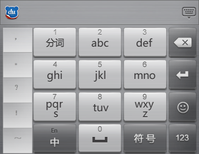

# 百度手机输入法 · 五笔梅花皮肤

一款自制的百度手机输入法（五笔/梅花）皮肤包，深色面板、梅花键盘布局，横竖屏均已适配。



## 下载安装

1. 点击仓库右上角绿色 **Code** 按钮 → **Download ZIP** 下载全部文件，或单独下载 `Info.txt`、`land/`、`port/`、`res/`
2. 将 `Info.txt`、`land/`、`port/`、`res/` 四项一起压缩为 zip 压缩包（注意四项需位于压缩包根目录）
3. 将 zip 文件后缀名改为 `.bds`
4. 将文件放入手机任意位置（也可放入 `Android/baidu/ime/skins/` 目录）
5. 用「百度输入法」打开该文件，或点击输入法面板熊头 logo 进入「超级皮肤」启用
6. 在「皮肤布局」页中选择本皮肤即可

## 目录结构

百度手机输入法的皮肤文件 `.bds` 本质是 zip 压缩包（改后缀为 `.zip` 即可解压），结构如下：

```
├── Info.txt      # 皮肤信息（名称、样式、支持平台）
├── demo.png      # 效果预览图
├── land/         # 横屏键盘布局（*.ini 配置 + *.cnd 候选条布局）
├── port/         # 竖屏键盘布局
└── res/          # 皮肤资源（按钮、背景等 png 图片 + til 样式描述）
```

## 自定义修改

- 背景图：替换 `res/back1.png`（面板背景）、`res/back2.png`（候选条），并同步修改对应 `.til` 中的 `SOURCE_RECT` 尺寸
- 按键布局：编辑 `port/*.ini` / `land/*.ini`，`VIEW_RECT` / `TOUCH_RECT` 控制按键位置与大小
- 修改完成后将 `Info.txt`、`land/`、`port/`、`res/` 一起压缩为 zip 并改后缀为 `.bds` 即可安装

## 环境说明

- 适配百度手机输入法（SupportPlatform=SWIA）
- 皮肤内部名称：`meihuawubi20261112DR`

## License

仅供学习交流使用。百度输入法相关版权归百度所有。
